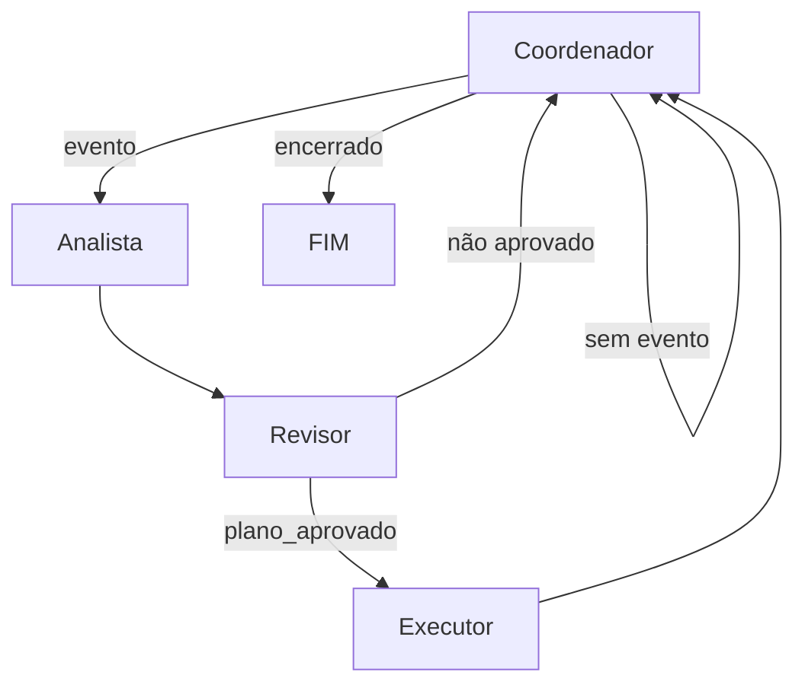
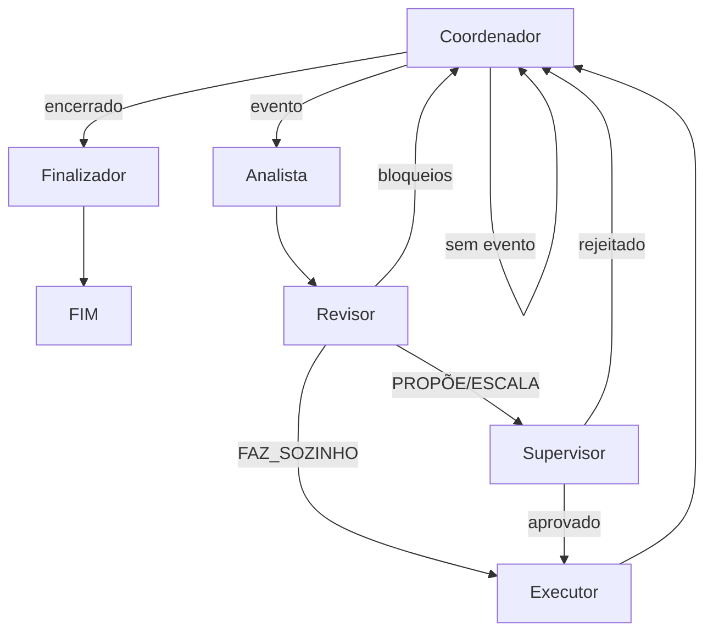

# Análise de Revisão do Projeto — Melhorias Propostas

Documento com a análise completa do código `graph.py` e propostas de melhorias para o sistema de gestão de equipamentos.

---

## 1. Resumo Executivo

O código está **coerente com o plano geral**, mas precisa de **ajustes no fluxo condicional** para lidar com:
1. Bloqueios do Revisor
2. Níveis PROPÕE e ESCALA
3. Rejeições sem perder eventos
4. Finalização limpa do cenário

**Status**: ✅ Arquitetura sólida | ⚠️ Fluxo incompleto | 🔴 Crítico: Falta nó Supervisor

---

## 2. Pontos Fortes — Alinhamento com o Plano

### ✅ Arquitetura LangGraph Correta

- Grafo bem estruturado com 4 nós (coordenador, analista, revisor, executor)
- Fluxo condicional apropriado: Coordenador → Analista → Revisor → Executor → [loop]
- Checkpoint SQLite implementado para persistência de estado

### ✅ Estado Compartilhado Bem Definido

`AgentState` (TypedDict) captura corretamente:
- Evento atual (evento_id, evento, origem)
- Resultado do Analista (tipo, entidades, plano)
- Resultado do Revisor (plano_aprovado, nivel_final, bloqueios)
- Execução (acoes_feitas, resposta_remetente)
- Contexto compartilhado (cache, pendências)

### ✅ Integração MCP Robusta

- Cliente MCP com retry exponencial (0.5s, 1s, 2s)
- Circuit breaker após 5 falhas consecutivas
- Idempotência com hash de evento_id + tool + args
- Tratamento de erros 503, 504, 409, 410 conforme especificação

### ✅ LLM com Cache e Fallback

- Classificação de 12 tipos de eventos
- Extração de entidades estruturada
- Reanalise automática se confiança < 0.7
- Tokens rastreados para observabilidade

### ✅ Regras de Negócio Implementadas

- 12 tipos de eventos mapeados
- 3 níveis de autonomia (FAZ_SOZINHO, PROPÕE, ESCALA)
- Limites de compra, prazos de devolução, empréstimo máximo
- Estoque mínimo verificado

---

## 3. Pontos de Atenção — Inconsistências Críticas

### 🔴 1. Fluxo de Retorno ao Coordenador (CRÍTICO)

**Código atual**:
```python
# Revisor -> Executor (se plano aprovado)
def deve_executar(state: AgentState) -> str:
    if state.get("plano_aprovado"):
        return "executor"
    return "coordenador"  # ← Volta ao coordenador se NÃO aprovado
```

**Problema**: Se o Revisor **rejeita** o plano (plano_aprovado = False), o fluxo volta ao Coordenador, que vai chamar `proximo_evento` novamente. Isso pode:
- Perder o evento atual (não será processado)
- Criar um loop infinito se o evento não for marcado como processado

**Recomendação**: O Revisor deve:
- Marcar o evento como `respondido` ou `observacao` se rejeitar
- Ou registrar a rejeição em `acoes_feitas` antes de voltar

**Código sugerido**:
```python
def deve_executar(state: AgentState) -> str:
    if state.get("bloqueios"):  # Se há bloqueios
        # Registrar bloqueio antes de voltar
        state["acoes_feitas"].append({
            "tool": "registrar_bloqueio",
            "motivo": "; ".join(state["bloqueios"]),
            "resultado": "bloqueado"
        })
        return "coordenador"
    if state.get("plano_aprovado"):
        return "executor"
    return "coordenador"
```

---

### 🔴 2. Falta de Tratamento de Bloqueios (CRÍTICO)

**Código atual**:
```python
# No revisor.py, há bloqueios detectados:
state["bloqueios"] = [...]  # razões de bloqueio
```

**Problema**: O grafo não verifica `bloqueios` antes de executar. Se há bloqueios, o Executor ainda tenta executar.

**Recomendação**: Adicionar lógica:
```python
def deve_executar(state: AgentState) -> str:
    if state.get("bloqueios"):  # Se há bloqueios
        return "coordenador"     # Não executa
    if state.get("plano_aprovado"):
        return "executor"
    return "coordenador"
```

---

### 🟡 3. Falta de Tratamento de Encerramento (MÉDIO)

**Código atual**:
```python
def deve_analisar(state: AgentState) -> str:
    if state.get("encerrado"):
        return END  # ✅ Correto
    if state.get("evento"):
        return "analista"
    return "coordenador"
```

**Problema**: Quando `encerrado=True`, o grafo termina. Mas não há:
- Geração de relatório final
- Limpeza de pendências
- Registro de métricas

**Recomendação**: Adicionar nó `finalizador` antes de END:
```python
def deve_analisar(state: AgentState) -> str:
    if state.get("encerrado"):
        return "finalizador"  # ← Novo nó
    if state.get("evento"):
        return "analista"
    return "coordenador"

def node_finalizador(state: AgentState) -> AgentState:
    """Finaliza o cenário com limpeza e relatório."""
    logger.info("Finalizando cenário...")
    # Gerar relatório
    # Limpar pendências
    # Registrar métricas
    return state

workflow.add_node("finalizador", node_finalizador)
workflow.add_edge("finalizador", END)
```

---

### 🔴 4. Falta de Nó para Casos de Rejeição (CRÍTICO)

Segundo a documentação técnica (seção 9 — Playbooks), há 3 níveis:
- **FAZ_SOZINHO**: Executor executa
- **PROPÕE**: Envia para supervisor (não há nó para isso)
- **ESCALA**: Envia para supervisor (não há nó para isso)

**Problema**: O grafo não tem nó para lidar com PROPÕE e ESCALA.

**Recomendação**: Adicionar nó `supervisor` que:
- Envia mensagem para supervisor
- Aguarda aprovação (ou timeout)
- Volta ao Executor se aprovado

```python
def node_supervisor(state: AgentState) -> AgentState:
    """Supervisor: aprova ou rejeita ações PROPÕE/ESCALA."""
    nivel = state.get("nivel_final", "FAZ_SOZINHO")
    
    if nivel == "FAZ_SOZINHO":
        # Não precisa de supervisor
        return state
    
    # Enviar para supervisor
    logger.info(f"Enviando para supervisor: {nivel}")
    
    # Simular aprovação (em produção, seria interativo)
    state["aprovado_supervisor"] = True
    
    return state

# No fluxo:
def deve_executar(state: AgentState) -> str:
    nivel = state.get("nivel_final", "FAZ_SOZINHO")
    
    if state.get("bloqueios"):
        return "coordenador"
    
    if nivel == "FAZ_SOZINHO":
        return "executor"
    elif nivel in ["PROPOE", "ESCALA"]:
        return "supervisor"  # ← Novo nó
    
    return "coordenador"

workflow.add_node("supervisor", node_supervisor)
workflow.add_edge("supervisor", "executor")
```

---

### 🟡 5. Timeout de 15 Segundos Não Configurado (MÉDIO)

**Código atual**:
```python
def criar_grafo(...):
    # Sem timeout configurado no grafo
    graph = workflow.compile(checkpointer=checkpointer)
```

**Problema**: A documentação exige timeout ≥ 15s. O LangGraph não tem timeout global configurado.

**Recomendação**: Adicionar timeout ao compilar:
```python
graph = workflow.compile(
    checkpointer=checkpointer,
    interrupt_before=["executor"],  # Opcional: pausar antes de executar
    timeout=40  # Se usar esperar_segundos=25
)
```

---

### 🟢 6. Falta de Tratamento de Erro nos Nós (BAIXO)

**Código atual**:
```python
def node_coordenador(state: AgentState) -> AgentState:
    return coordenador(state, mcp, clock)
```

**Problema**: Se `coordenador()` lança exceção, o grafo falha. Não há try/catch.

**Recomendação**: Adicionar tratamento:
```python
def node_coordenador(state: AgentState) -> AgentState:
    try:
        return coordenador(state, mcp, clock)
    except Exception as e:
        logger.error(f"Erro no coordenador: {e}")
        state["erros"].append(str(e))
        return state
```

---

## 4. Diagrama de Fluxo Atual vs. Esperado

### Fluxo Atual (Incompleto)



### Fluxo Esperado (Com Melhorias)



---

## 5. Matriz de Prioridades

| Prioridade | Ação | Impacto | Esforço |
|-----------|------|--------|--------|
| 🔴 Alta | Adicionar verificação de `bloqueios` antes de executar | Evita execução de ações bloqueadas | 30 min |
| 🔴 Alta | Implementar nó `supervisor` para PROPÕE/ESCALA | Cumpre contrato de 3 níveis | 1h |
| 🟡 Média | Adicionar nó `finalizador` | Gera relatório e limpa pendências | 45 min |
| 🟡 Média | Tratar rejeição do Revisor (marcar evento) | Evita perda de eventos | 30 min |
| 🟢 Baixa | Adicionar timeout global | Segurança contra travamentos | 15 min |
| 🟢 Baixa | Adicionar try/catch nos nós | Resiliência | 30 min |

---

## 6. Plano de Implementação

### Fase 1: Correções Críticas (2-3 horas)

1. **Adicionar verificação de bloqueios**
   - Arquivo: `src/graph.py`
   - Função: `deve_executar()`
   - Mudança: Verificar `state.get("bloqueios")` antes de executar

2. **Implementar nó Supervisor**
   - Arquivo: `src/agents/supervisor.py` (novo)
   - Responsabilidade: Aprovar/rejeitar PROPÕE e ESCALA
   - Integração: Adicionar ao grafo entre Revisor e Executor

### Fase 2: Melhorias Médias (1-2 horas)

3. **Adicionar nó Finalizador**
   - Arquivo: `src/agents/finalizador.py` (novo)
   - Responsabilidade: Gerar relatório, limpar pendências
   - Integração: Adicionar antes de END

4. **Melhorar tratamento de rejeição**
   - Arquivo: `src/agents/revisor.py`
   - Mudança: Registrar rejeição antes de voltar ao Coordenador

### Fase 3: Refinamentos (30-45 min)

5. **Adicionar timeout global**
   - Arquivo: `src/graph.py`
   - Função: `criar_grafo()`
   - Mudança: Configurar timeout no compile()

6. **Adicionar try/catch nos nós**
   - Arquivo: `src/graph.py`
   - Mudança: Envolver cada nó com tratamento de erro

---

## 7. Checklist de Validação

Após implementar as melhorias, validar:

- [ ] Bloqueios impedem execução de ações
- [ ] Nó Supervisor recebe eventos PROPÕE/ESCALA
- [ ] Supervisor aprova/rejeita corretamente
- [ ] Finalizador gera relatório ao encerrar
- [ ] Eventos rejeitados não são perdidos
- [ ] Timeout global está configurado
- [ ] Erros em nós são capturados e registrados
- [ ] Testes cobrem novo fluxo (PROPÕE/ESCALA)
- [ ] Documentação atualizada

---

## 8. Referências

- [Análise Anterior](ANALISE_REVISAO.md) — Este documento
- [Regras de Negócio](REGRAS_NEGOCIO.md) — 3 níveis de autonomia
- [Agentes](AGENTES.md) — Responsabilidades de cada agente
- [Documentação Técnica](DOCUMENTACAO_TECNICA.md) — Contrato MCP
- [Código do Grafo](../src/graph.py) — Implementação atual

---

## 9. Conclusão

O projeto tem uma **arquitetura sólida** e está bem alinhado com o plano. As melhorias propostas são **incrementais** e **não quebram** o código existente. Implementar as correções críticas (Fase 1) é essencial para cumprir o contrato de 3 níveis de autonomia.

**Próximos passos**:
1. Implementar nó Supervisor (crítico)
2. Adicionar verificação de bloqueios (crítico)
3. Adicionar nó Finalizador (médio)
4. Escrever testes para novo fluxo
5. Atualizar documentação
