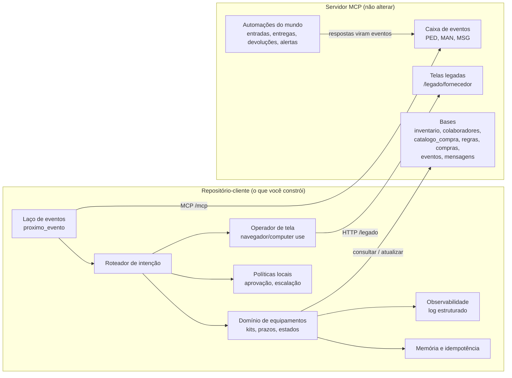
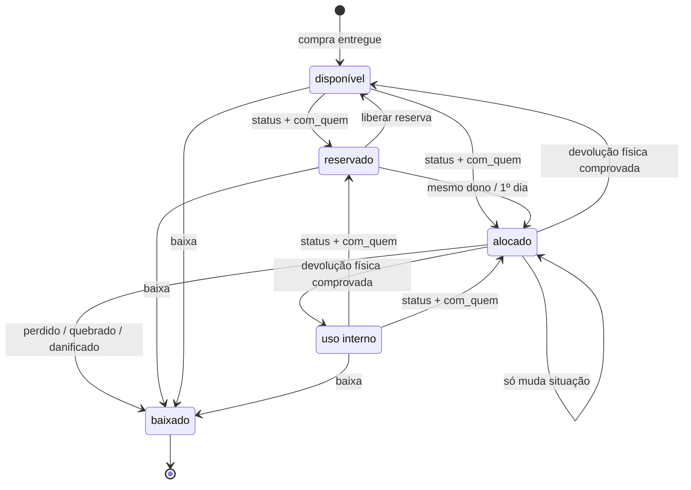

# Documentação técnica — Tema 3 (Gestão de equipamentos)

Guia para construir, em outro repositório, o **cliente e os agentes** que operam o servidor MCP do Hackathon UNIFEI 2026 neste tema.

> **Fonte da verdade:** este documento foi derivado do código em `Hackathon - UNIFEI 2026/Servidor MCP (Compartilhado)/` (`hackathon/nucleo.py`, `hackathon/temas/equipamentos.py`, `hackathon/painel.py`, `hackathon/legado.py`, `mundo.py`) e das bases em `dados/equipamentos/`. Se o servidor mudar, o código prevalece.
>
> **Dados fictícios.** Pessoas, e-mails, patrimônios, preços e eventos não são reais. Nunca commite chaves, tokens ou arquivos `.env`.
>
> **Não altere o servidor.** O repositório-cliente deve se adaptar ao contrato descrito aqui. O servidor é o mundo; ele não chama o agente.

---

## Sumário

1. [Objetivo, escopo e não-objetivos](#1-objetivo-escopo-e-não-objetivos)
2. [Arquitetura de referência](#2-arquitetura-de-referência)
3. [Contrato de conexão MCP](#3-contrato-de-conexão-mcp)
4. [Ferramentas](#4-ferramentas)
5. [Bases de dados](#5-bases-de-dados)
6. [Inventário: máquina de estados e regras](#6-inventário-máquina-de-estados-e-regras)
7. [Eventos, relógio e automações do mundo](#7-eventos-relógio-e-automações-do-mundo)
8. [Catálogo completo dos 52 eventos](#8-catálogo-completo-dos-52-eventos)
9. [Playbooks operacionais](#9-playbooks-operacionais)
10. [Portal do fornecedor (só tela)](#10-portal-do-fornecedor-só-tela)
11. [Cliente de referência](#11-cliente-de-referência)
12. [Observabilidade e critérios de aceitação](#12-observabilidade-e-critérios-de-aceitação)
13. [Segurança, aprovação e armadilhas](#13-segurança-aprovação-e-armadilhas)
14. [Ambiente local e configuração do cliente](#14-ambiente-local-e-configuração-do-cliente)
15. [Referência rápida](#15-referência-rápida)

---

## 1. Objetivo, escopo e não-objetivos

### 1.1 O que o outro repositório deve conter

Um time de agentes que:

1. conecta ao servidor MCP por **Streamable HTTP** em `http://localhost:8765/mcp`;
2. consome eventos em laço com `proximo_evento` até `encerrado: true`;
3. classifica cada evento e escolhe um playbook;
4. consulta as bases antes de agir;
5. executa ações com `atualizar`, `responder_evento`, `enviar_mensagem` e, quando necessário, operando o portal do fornecedor por navegador;
6. registra decisões, aprovações e conversas entre agentes;
7. trata falhas simuladas sem duplicar efeitos;
8. encerra de forma limpa quando o cenário termina.

### 1.2 Não-objetivos

- Reimplementar o servidor ou “corrigir” as bases.
- Criar endpoints novos ou alterar `dados/`.
- Assumir que o servidor guarda memória, escalação ou aprovação: **isso é responsabilidade do cliente**.
- Tratar os dados como reais ou usar dados de pessoas reais.

### 1.3 Pré-requisitos

- Servidor no ar (`TEMA=equipamentos`) e painel acessível.
- Cliente MCP com timeout de **15 segundos ou mais** (algumas falhas levam até 9 s). Se usar `esperar_segundos`, o timeout precisa ser **maior que a espera** (ex.: esperar 25 s → timeout de 40 s).
- Um nome de agente por papel (ex.: `orquestrador`, `estoque`, `compras`, `supervisor`), com até 60 caracteres.

---

## 2. Arquitetura de referência



### 2.1 Layout sugerido no repositório-cliente

```text
src/
├── config.ts|py              # URL do MCP, nome do agente, timeouts, seed
├── mcp/
│   ├── client.ts|py          # conexão, initialize, tools/call, reconexão
│   └── errors.ts|py          # ErroFerramenta e política de retry
├── loop/
│   ├── runner.ts|py          # laço até encerrado
│   └── router.ts|py          # classificação do evento
├── domain/
│   ├── equipamentos.ts|py    # kits, estados, prazos, consultas
│   ├── eventos.ts|py         # flags, origens, responde_a
│   └── fornecedor.ts|py      # compras e previsões
├── policies/
│   ├── aprovacao.ts|py       # limites e alçadas
│   └── escalacao.ts|py       # quando chamar humano
├── legacy/
│   └── portal-fornecedor.ts|py
├── memory/
│   └── ledger.ts|py          # idempotência e decisões
└── observability/
    └── logger.ts|py
```

### 2.2 Papéis de agente sugeridos

| Agente           | Responsabilidade                                  | Ferramentas principais                                     |
| ---------------- | ------------------------------------------------- | ---------------------------------------------------------- |
| `orquestrador` | pega evento, classifica, delega, fecha o ciclo    | `proximo_evento`, `ler_evento`, `registrar_conversa` |
| `estoque`      | inventário, kits, reservas, devoluções, baixas | `consultar`, `atualizar`                               |
| `compras`      | análise de estoque e compra no portal            | `consultar`, `catalogo_compra`, tela do fornecedor     |
| `atendimento`  | respostas a dúvidas e cobranças                 | `responder_evento`, `enviar_mensagem`                  |
| `supervisor`   | aprovações, exceções e casos ambíguos        | `enviar_mensagem`, `registrar_conversa`                |

O servidor não orquestra: todos os agentes são processos do seu repositório. Use `registrar_conversa` para deixar a coordenação visível no painel e no log.

---

## 3. Contrato de conexão MCP

### 3.1 Endpoints

| O quê                         | Endereço                                   |
| ------------------------------ | ------------------------------------------- |
| Servidor MCP (Streamable HTTP) | `http://localhost:8765/mcp`               |
| Painel ao vivo                 | `http://localhost:8765/`                  |
| Estado em JSON                 | `http://localhost:8765/api/estado`        |
| Stream do painel (SSE)         | `http://localhost:8765/api/eventos`       |
| Telas legadas                  | `http://localhost:8765/legado`            |
| Portal do fornecedor           | `http://localhost:8765/legado/fornecedor` |

### 3.2 Handshake

1. `POST /mcp` com `initialize`.
2. Guardar o header de resposta `Mcp-Session-Id`.
3. Enviar `notifications/initialized` (o servidor responde `202`).
4. Reutilizar `Mcp-Session-Id` em todas as requisições.
5. Em restart do servidor, a sessão deixa de existir: reconecte e refaça o handshake.

Headers:

```http
Accept: application/json, text/event-stream
Content-Type: application/json
Mcp-Session-Id: <valor retornado no initialize>
```

A resposta pode vir como JSON ou como SSE (`event: message` + `data: {...}`). O cliente precisa aceitar os dois formatos.

### 3.3 Envelope das ferramentas

Toda chamada é `tools/call` com `arguments`. Em **todas** as ferramentas, `agente` é obrigatório; `motivo` é opcional e aparece no painel.

```json
{
  "jsonrpc": "2.0",
  "id": 7,
  "method": "tools/call",
  "params": {
    "name": "consultar",
    "arguments": {
      "agente": "estoque",
      "motivo": "conferir itens da saída do André",
      "base": "inventario",
      "filtro": { "com_quem": "C-019" }
    }
  }
}
```

Sucesso:

```json
{
  "status": "ok",
  "base": "inventario",
  "total": 3,
  "offset": 0,
  "registros": [],
  "tem_mais": false,
  "agora": "seg 01/12/2026 09:10"
}
```

Erro:

```json
{
  "status": "erro",
  "codigo": 409,
  "mensagem": "EQ-0002 está alocado com C-019.",
  "agora": "seg 01/12/2026 09:12"
}
```

O resultado MCP vem em `content[0].text` (string JSON) e `isError: true` quando há erro de regra. **Sempre** faça `JSON.parse` do texto antes de decidir.

### 3.4 Ciclo de vida, relógio e timeout

- O relógio começa na **primeira chamada** de qualquer agente, MCP ou tela. Antes disso, `agora` fica em `seg 01/12/2026 08:00`.
- `agora` acompanha todas as respostas no formato `dia dd/mm/aaaa hh:mm`.
- `proximo_evento` devolve `encerrado: true` e `evento: null` ao final dos 22 dias.
- Depois do fim: leituras continuam; ações (`atualizar`, `responder_evento`, `enviar_mensagem`, `registrar`, telas) devolvem **410**.
- Reiniciar o servidor zera tudo. Reconecte.
- Timeout do cliente: **≥ 15 s**. Falhas lentas levam de 2 a 5 s; timeouts simulados, de 5 a 9 s. Com `esperar_segundos`, use timeout maior que a espera (espera 25 s → timeout 40 s).
- **15% das chamadas falham de propósito**: `503`, lentidão (2–5 s), `504` ambíguo e `409` de conflito. Leituras não sofrem o `409` simulado.
- No `504` de uma ação, o servidor pode ter executado a ação (cerca de 50% das vezes) antes de responder o erro. Por isso, **confira o estado antes de repetir**.

### 3.5 Política de retry (obrigatória)

| Situação                   | Ação correta                                                   |
| ---------------------------- | ---------------------------------------------------------------- |
| `503`                      | tentar de novo após 1–3 s, com limite de tentativas            |
| lento (2–5 s)               | apenas aguardar; não duplicar                                   |
| `504` em leitura           | nada mudou; repetir é seguro                                    |
| `504` em ação            | **pode ter executado**; conferir o estado antes de repetir |
| `409` de conflito simulado | reconsultar e decidir; não repetir às cegas                    |
| `409` de regra             | o item mudou ou está com outra pessoa; reconsultar              |
| `422`                      | não repetir; corrigir dados ou escalar                          |
| `410`                      | encerrar ações e gerar relatório final                        |
| `500`                      | falha real do servidor; registrar e avisar a organização       |

Antes de repetir uma ação após `504`, confira:

- `enviar_mensagem` → base `mensagens` por `evento_id`, `para` ou assunto;
- compra na tela → base `compras` por `evento_id`/`pedido_por`;
- `atualizar` → `consultar` o patrimônio e comparar o estado;
- `responder_evento` → `ler_evento` e ver `acoes`/`status`.

---

## 4. Ferramentas

São 10 ferramentas genéricas, iguais em todos os temas.

| Ferramenta             | Leitura | Falha simulada     | Parâmetros obrigatórios               | Para quê                                                      |
| ---------------------- | ------- | ------------------ | --------------------------------------- | -------------------------------------------------------------- |
| `proximo_evento`     | sim     | sim (sem conflito) | `agente`                              | pega o próximo evento `novo`; `esperar_segundos` 0–30    |
| `listar_eventos`     | sim     | sim                | `agente`                              | lista com filtro de `status` e paginação                   |
| `ler_evento`         | sim     | sim                | `agente`, `evento_id`               | lê um evento com `acoes`                                    |
| `responder_evento`   | não    | sim                | `agente`, `evento_id`, `mensagem` | responde ao remetente e marca `respondido`                   |
| `enviar_mensagem`    | não    | sim                | `agente`, `para`, `mensagem`      | e-mail para pessoa/time; `assunto` e `evento_id` opcionais |
| `listar_bases`       | sim     | sim                | `agente`                              | descreve bases, campos e permissões                           |
| `consultar`          | sim     | sim                | `agente`, `base`                    | filtro por campo e busca textual; paginação                  |
| `registrar`          | não    | sim                | `agente`, `base`, `dados`         | criar registro — **no Tema 3 sempre 405**               |
| `atualizar`          | não    | sim                | `agente`, `base`, `id`, `dados` | alterar registro pela chave                                    |
| `registrar_conversa` | não    | **não**     | `agente`, `para`, `mensagem`      | só registra no painel/log; não entrega nada                  |

> **Atenção:** no Tema 3 **nenhuma base aceita `registrar`**. As cinco bases do tema e as duas globais respondem `405`. Para registrar uma compra, use o portal do fornecedor; para registrar uma devolução, use `atualizar` no inventário.

### 4.1 `proximo_evento`

Entrada:

```json
{
  "agente": "orquestrador",
  "esperar_segundos": 25
}
```

Retorno com evento:

```json
{
  "status": "ok",
  "evento": {
    "id": "PED-005",
    "de": "juliana.rocha@t4h.exemplo",
    "nome": "Juliana Rocha",
    "assunto": "Notebook com bateria estufada",
    "corpo": "Oi, meu notebook (EQ-0064) tá com a bateria estufada...",
    "chegou_em": "ter 02/12/2026 11:30",
    "status": "lido",
    "responde_a": null,
    "origem": "cenario",
    "acoes": [],
    "lido_por": "orquestrador"
  },
  "encerrado": false,
  "agora": "ter 02/12/2026 11:32"
}
```

Retorno sem evento:

```json
{
  "status": "ok",
  "evento": null,
  "mensagem": "Nenhum evento novo agora. Espere e pergunte de novo.",
  "encerrado": false,
  "proximo_evento_do_cenario": {
    "hora_simulada": "ter 02/12/2026 16:05",
    "em_segundos_reais": 18.4
  },
  "agora": "ter 02/12/2026 15:21"
}
```

Regras:

- O evento é marcado como `lido` e `lido_por` recebe o agente.
- A ordem é a de chegada (inserção), não a de `dia`/`hora` originais.
- `esperar_segundos` segura a resposta até aparecer um evento `novo` ou o cenário terminar.

### 4.2 `listar_eventos` e `ler_evento`

`listar_eventos` aceita `status`, `limite` (padrão 50, máx. 200) e `offset`. Retorna `total`, `eventos`, `tem_mais`. A lista traz só `id`, `de`, `assunto`, `status`, `chegou_em`, `responde_a`, `origem`.

`ler_evento` devolve o evento completo, incluindo `corpo`, `acoes` e `observacao` (se gravada).

### 4.3 `responder_evento`

- Responde ao campo `de` do evento (não escolhe outro destinatário).
- Marca o evento como `respondido` e adiciona uma ação `responder_evento`.
- `aguardar_resposta: true` só é útil nos Temas 1 e 2. **No Tema 3 ninguém responde a `responder_evento`**; o retorno dirá que a pessoa não costuma responder.
- Pode ser chamado mais de uma vez; evite duplicidade controlando localmente.

### 4.4 `enviar_mensagem`

- `para` precisa ser um e-mail existente: alguém da base `colaboradores` **ou** o remetente de um evento da caixa.
- Retorna `mensagem_id` (`ENV-###`), `entregue_para` e `vai_responder`.
- No Tema 3, só há resposta automática quando o texto (assunto + mensagem, sem acento) contém `devol` e o destinatário é um colaborador. A resposta chega de 4 a 20 horas simuladas depois.
- **Mensagem para endereço fora de `@t4h.exemplo` gera alerta grave** e, na prática, termina em `404`. Não use e-mail externo.
- Para responder a quem mandou um evento, prefira `responder_evento`.

### 4.5 `listar_bases` e `consultar`

`listar_bases` retorna, por base: `base`, `descricao`, `total`, `chave`, `campos`, `pode_registrar`, `pode_atualizar`, além de `campos_para_registrar` e `exemplo_registrar` quando aplicável.

`consultar`:

- `filtro` é um objeto `{campo: valor}`. A comparação é **substring, sem acento e sem diferenciar maiúsculas**: `{"status":"disponivel"}` encontra `disponível`.
- `busca` exige que **todas** as palavras apareçam em algum campo do registro (JSON serializado).
- `limite` padrão 20, máximo 100; `offset` para paginar.
- Campo inexistente no filtro não gera erro, mas costuma não retornar nada; a resposta pode trazer `aviso_filtro`.
- Quando há mais resultados, vem `aviso` com o próximo `offset`.

### 4.6 `atualizar`

- `id` é o valor da chave da base (`patrimonio` no inventário, `id` em eventos).
- `dados` precisa ser objeto não vazio.
- Campos fora de `campos_atualizaveis` geram `422` antes mesmo de localizar o registro.
- Com `evento_id`, a ação conta como atendimento do evento.
- Em `eventos`, só `status` e `observacao` podem ser alterados; **isso não conta como atendimento**.

### 4.7 `registrar_conversa`

- Parâmetros: `de` (opcional; padrão é o próprio `agente`), `para`, `mensagem`.
- Só aparece no painel e no log. Não entrega nada e não conta como ação de evento.
- É a forma recomendada de tornar visível a coordenação entre agentes.

---

## 5. Bases de dados

### 5.1 Visão geral

| Base                | Chave          | Registros no início | Registrar | Atualizar                                                                                                  |
| ------------------- | -------------- | -------------------- | --------- | ---------------------------------------------------------------------------------------------------------- |
| `eventos`         | `id`         | 0 (cresce)           | não      | `status`, `observacao`                                                                                 |
| `mensagens`       | `id`         | 0 (cresce)           | não      | não                                                                                                       |
| `inventario`      | `patrimonio` | 150                  | não      | `status`, `situacao`, `com_quem`, `desde`, `numero_serie`, `marca`, `modelo`, `observacao` |
| `colaboradores`   | `id`         | 40                   | não      | não                                                                                                       |
| `catalogo_compra` | `tipo`       | 5                    | não      | não                                                                                                       |
| `regras`          | `regra`      | 8                    | não      | não                                                                                                       |
| `compras`         | `id`         | 0 (cresce)           | não      | não                                                                                                       |

### 5.2 `eventos`

Campos: `id`, `de`, `nome`, `assunto`, `corpo`, `chegou_em`, `status`, `responde_a`, `origem`, `acoes`, `observacao`.

- `status` do sistema: `novo` → `lido` → `respondido`. O time pode gravar qualquer outro valor (até 200 caracteres).
- `origem`: `cenario`, `painel` ou `mundo`.
- `acoes`: lista de `{ferramenta, agente, agora}`.
- `responde_a`: id do evento original, quando é resposta.
- `observacao`: até 2.000 caracteres; não conta como atendimento.

### 5.3 `mensagens`

Campos: `id` (`ENV-###`), `para`, `assunto`, `mensagem`, `agente`, `evento_id`, `enviada_em`.

É o livro-caixa do que o time enviou. Use para conferir um envio que deu `504` antes de repetir.

### 5.4 `inventario`

Campos:

| Campo            | Observação                                                                               |
| ---------------- | ------------------------------------------------------------------------------------------ |
| `patrimonio`   | chave, formato `EQ-####`; imutável                                                      |
| `tipo`         | `notebook`, `monitor`, `headset`, `kit teclado e mouse`, `carregador`; imutável |
| `marca`        | atualizável                                                                               |
| `modelo`       | atualizável                                                                               |
| `numero_serie` | atualizável                                                                               |
| `status`       | `disponível`, `reservado`, `alocado`, `uso interno`, `baixado`                  |
| `situacao`     | `novo`, `usado`, `quebrado`, `danificado`, `perdido`                             |
| `com_quem`     | id do colaborador (`C-###`) quando reservado/alocado                                     |
| `desde`        | data de início da reserva/alocação (`AAAA-MM-DD`)                                     |
| `observacao`   | até 2.000 caracteres; use para data de devolução de empréstimo                         |

Distribuição inicial (150 itens):

| Dimensão         | Valores                                                                          |
| ----------------- | -------------------------------------------------------------------------------- |
| Tipo              | 47 notebook, 35 kit teclado e mouse, 34 headset, 29 monitor, 5 carregador        |
| Status            | 113 alocado, 17 disponível, 12 baixado, 5 uso interno, 3 reservado              |
| Situação        | 123 usado, 17 novo, 6 quebrado, 3 danificado, 1 perdido                          |
| Reservas          | `EQ-0030` notebook C-016, `EQ-0038` monitor C-031, `EQ-0069` headset C-025 |
| Uso interno       | `EQ-0094`, `EQ-0100`, `EQ-0104`, `EQ-0106`, `EQ-0132`                  |
| Livres e usáveis | 6 notebook, 4 kit, 4 headset, 2 carregador, 1 monitor                            |

### 5.5 `colaboradores`

Campos: `id` (`C-###`), `nome`, `email`, `cargo`, `area`, `data_entrada`, `data_saida`.

- `data_saida` vazia = ativo.
- `saiu()` compara `data_saida <= hoje`: **no próprio dia da saída a pessoa já conta como saída**.
- Entradas no cenário: Gabriel Tavares (08/12), Mateus Prado (09/12), Isabela Cunha (14/12), Letícia Macedo (21/12), Otávio Siqueira (28/12).
- Saídas no cenário: André Monteiro (04/12), Diego Almeida (11/12), Henrique Dias (16/12), Camila Teixeira (22/12).
- Saídas anteriores ao cenário: Leonardo Brito (13/11) e Tatiane Ramos (27/11) continuam com itens e **não geram alerta automático** — encontrá-los é trabalho do agente (ver `PED-049`).

Áreas e kit:

| Área           | Kit                                                |
| --------------- | -------------------------------------------------- |
| Qualquer área  | `notebook`, `headset`, `kit teclado e mouse` |
| Desenvolvimento | kit padrão + `monitor`                          |
| Design          | kit padrão + `monitor`                          |
| Demais áreas   | kit padrão, sem monitor                           |

### 5.6 `catalogo_compra`

| Tipo                | Modelo                   |      Preço | Prazo (dias úteis) |
| ------------------- | ------------------------ | ----------: | ------------------: |
| notebook            | Dell Latitude 5440       | R$ 4.800,00 |                  10 |
| monitor             | LG 24MK430H              |   R$ 890,00 |                   7 |
| headset             | Logitech H390            |   R$ 320,00 |                   3 |
| kit teclado e mouse | Logitech MK270           |   R$ 180,00 |                   3 |
| carregador          | Dell Adaptador USB-C 65W |   R$ 260,00 |                   5 |

### 5.7 `regras`

| Regra                            | Valor                                  | Uso                                        |
| -------------------------------- | -------------------------------------- | ------------------------------------------ |
| `kit_padrao`                   | notebook, headset, kit teclado e mouse | kit mínimo                                |
| `kit_extra_por_area`           | Desenvolvimento/Design → monitor      | kit adicional                              |
| `prazo_kit_dias_uteis_antes`   | 2                                      | kit pronto 2 dias úteis antes da entrada  |
| `devolucao_dias_uteis`         | 5                                      | prazo de devolução após saída          |
| `escalar_devolucao_dias_uteis` | 10                                     | escalonamento                              |
| `emprestimo_dias_max`          | 30                                     | limite de empréstimo                      |
| `limite_compra_sem_aprovacao`  | 500                                    | compras acima de R$ 500 exigem aprovação |
| `estoque_minimo`               | 3                                      | mínimo de itens livres por tipo           |

O servidor **não aplica** `prazo_kit_dias_uteis_antes`, `emprestimo_dias_max` nem `limite_compra_sem_aprovacao`. Ele apenas expõe as regras (e, no caso do limite, gera alerta informativo na compra). A aplicação é do cliente.

### 5.8 `compras`

Campos: `id` (`FORN-####`), `tipo`, `modelo`, `quantidade`, `valor`, `previsao`, `status`, `pedido_por`, `evento_id`, `pedido_em`, `patrimonios`.

- Só nasce pelo portal do fornecedor.
- `status` começa em `a caminho`; vira `entregue` quando chega.
- Na entrega, cada unidade vira um `EQ-####` novo em `disponível`/`novo`, e o fornecedor manda um evento de confirmação.
- `evento_id` liga a compra ao evento que a motivou.

---

## 6. Inventário: máquina de estados e regras

### 6.1 Diagrama



### 6.2 Matriz de transições

| De                                                | Para                                                                | Pré-condições                                                                               | Erro se violar                                                                                        |
| ------------------------------------------------- | ------------------------------------------------------------------- | ---------------------------------------------------------------------------------------------- | ----------------------------------------------------------------------------------------------------- |
| `disponível` / `uso interno`                 | `reservado` / `alocado`                                         | `com_quem` resolve para um colaborador; pessoa não saiu; `situacao` `novo` ou `usado` | 422 (sem `com_quem`, pessoa saiu, item não usável); 404 (pessoa inexistente); 422 (nome ambíguo) |
| `reservado` / `alocado`                       | mesmo status do mesmo dono                                          | `com_quem` do item é o mesmo                                                                | —                                                                                                    |
| `reservado` / `alocado`                       | outro dono                                                          | precisa devolver antes                                                                         | 409                                                                                                   |
| `reservado`                                     | `alocado`                                                         | mesmo dono; `com_quem` pode ser omitido                                                      | —                                                                                                    |
| `alocado`                                       | `alocado` com nova `situacao`                                   | mesmo dono                                                                                     | —                                                                                                    |
| `alocado`                                       | `disponível` / `uso interno`                                   | devolução física registrada (evento do cenário ou resposta de devolução)                 | 409                                                                                                   |
| `reservado`                                     | `disponível` / `uso interno`                                   | não exige devolução física                                                                 | —                                                                                                    |
| `alocado`                                       | `baixado`                                                         | `situacao` em `perdido`, `quebrado` ou `danificado`; mantém `com_quem`              | 422                                                                                                   |
| `reservado` / `disponível` / `uso interno` | `baixado`                                                         | baixa definitiva; limpa `com_quem`/`desde`                                                 | —                                                                                                    |
| `baixado`                                       | qualquer status ou `com_quem`                                     | baixa é definitiva                                                                            | 409                                                                                                   |
| `baixado`                                       | outros campos (`situacao`, `observacao`, série, marca, modelo) | permitido                                                                                      | —                                                                                                    |
| Qualquer não baixado                             | só `situacao`                                                    | permitido, inclusive `alocado` com defeito                                                   | —                                                                                                    |

Regras adicionais:

- `com_quem` aceita **id**, **e-mail exato** ou **nome**; a comparação de nome é substring sem acento. Nome que bate com mais de uma pessoa devolve `422` com as opções; use o id.
- `com_quem` sozinho **não aloca**: é obrigatório informar também `status` (`reservado` ou `alocado`). Sem isso, o campo é limpo em um item `disponível`.
- `reservado`/`alocado` sem `com_quem` → `422`.
- Passar um item para outra pessoa sem devolver antes → `409`.
- `desde` é preenchido com a data simulada atual quando a alocação é nova; pode ser informado.
- Ao alocar para um novo dono, a marca de devolução anterior é consumida.
- `observacao` limitada a 2.000 caracteres; demais textos são convertidos para string.
- `registrar` no inventário é sempre `405`; itens novos só nascem de compras entregues.
- Em `disponível`/`uso interno`, `com_quem` e `desde` são limpos automaticamente.
- Itens `alocado` baixados por perda/avaria **guardam** `com_quem`, para rastreabilidade.

### 6.3 Exemplos corretos

Reservar kit para uma entrada futura:

```json
{
  "agente": "estoque",
  "base": "inventario",
  "id": "EQ-0028",
  "dados": { "status": "reservado", "com_quem": "C-037" },
  "evento_id": "PED-004"
}
```

Converter reserva em alocação no primeiro dia (ou antes):

```json
{
  "agente": "estoque",
  "base": "inventario",
  "id": "EQ-0028",
  "dados": { "status": "alocado" }
}
```

Registrar defeito sem trocar de dono:

```json
{
  "agente": "estoque",
  "base": "inventario",
  "id": "EQ-0064",
  "dados": { "situacao": "danificado", "observacao": "Bateria estufada; touchpad levantado (PED-005)." },
  "evento_id": "PED-005"
}
```

Registrar devolução depois do evento de retorno físico:

```json
{
  "agente": "estoque",
  "base": "inventario",
  "id": "EQ-0002",
  "dados": { "status": "disponível" },
  "evento_id": "PED-013"
}
```

Baixa por perda:

```json
{
  "agente": "estoque",
  "base": "inventario",
  "id": "EQ-0117",
  "dados": { "situacao": "perdido", "status": "baixado", "observacao": "Perdido em transporte por aplicativo (PED-034)." },
  "evento_id": "PED-034"
}
```

### 6.4 Erros comuns e como reagir

| Sintoma                                | Causa provável                           | Correção                                                          |
| -------------------------------------- | ----------------------------------------- | ------------------------------------------------------------------- |
| `409` ao mudar `com_quem`          | item ainda alocado para outra pessoa      | registrar devolução primeiro                                      |
| `409` ao voltar para `disponível` | devolução física ainda não registrada | aguardar evento de devolução ou resposta da pessoa                |
| `409` ao mexer em `baixado`        | baixa é definitiva                       | não tentar reverter; abrir exceção local                         |
| `422` em `situacao`                | valor fora do enum                        | usar `novo`, `usado`, `quebrado`, `danificado`, `perdido` |
| `422` em `com_quem`                | pessoa saiu ou item não usável          | escolher outra pessoa/item                                          |
| `404` em `com_quem`                | id/e-mail/nome inexistente                | consultar `colaboradores`                                         |
| `422` “Mais de um colaborador”     | nome ambíguo                             | usar o `id`                                                       |

### 6.5 Devolução física: como o mundo comprova

Há três caminhos:

1. **Evento do cenário com `devolve.patrimonios`** (ex.: `PED-013`, `PED-036`, `PED-042`): os patrimônios entram no conjunto de devolvidos.
2. **Evento do cenário com `devolve.colaborador` + `tipo` + `quantidade`** (ex.: `PED-028`, `PED-044`, `PED-048`): cria uma cota; cada item daquele tipo e daquele colaborador liberado consome uma unidade.
3. **Resposta automática a uma mensagem que contém “devol”**, quando a pessoa já saiu: com 70% de chance ela confirma e todos os patrimônios atuais dela entram como devolvidos; com 30%, promete devolver depois.

O que **não** comprova devolução:

- evento criado no painel (`origem: painel`);
- mudar o `status` do evento;
- criar uma observação;
- dizer que devolveu sem evento/resposta correspondente.

Ao liberar um item, a marca de devolução é consumida. Se o item for realocado, a marca não vale mais. Em devoluções por cota (`colaborador` + `tipo` + `quantidade`), libere o patrimônio que realmente voltou: o mundo aceita qualquer item do mesmo tipo e dono, mas o inventário ficaria errado. Use a `observacao` do empréstimo (data de retorno e motivo) para identificar o item certo.

---

## 7. Eventos, relógio e automações do mundo

### 7.1 Origem e identificadores

| Prefixo        | Origem                        | Exemplo        |
| -------------- | ----------------------------- | -------------- |
| `PED-###`    | cenário                      | `PED-005`    |
| `PED-###-R#` | resposta do mundo a um evento | `PED-005-R1` |
| `MSG-###`    | mensagem autônoma do mundo   | `MSG-003`    |
| `MAN-###`    | painel (“+ Novo evento”)    | `MAN-001`    |
| `ENV-###`    | mensagem enviada pelo time    | `ENV-004`    |
| `FORN-####`  | compra no portal              | `FORN-0001`  |
| `EQ-####`    | patrimônio                   | `EQ-0064`    |
| `C-###`      | colaborador                   | `C-019`      |

### 7.2 Flags de cenário

- `se_sem_acao: "PED-005"`: o evento só chega se o original **não** tiver nenhuma ação.
- `se_com_acao: "PED-009"`: o evento só chega se o original **tiver** alguma ação.
- `devolve`: só é aplicado quando o evento chega e a origem é `cenario`.
- Esses três campos são do arquivo de cenário e **não aparecem** no evento devolvido pelo MCP.
- “Ação” significa: `responder_evento`, `enviar_mensagem`, `atualizar` com `evento_id` em uma base que não seja `eventos`, `registrar` (quando a base aceita — não é o caso deste tema) ou uma tela com `evento` vinculado. **Mudar só o status/observação do evento não conta.**

### 7.3 Relógio e janelas

- Expediente: 08:00–18:00, somente dias úteis.
- 22 dias no Tema 3; 55 segundos reais por dia; ~20 minutos de rodada.
- Eventos chegam com variação de ±15 minutos simulados.
- `proximo_evento_do_cenario.em_segundos_reais` ajuda a calibrar esperas.
- Não há cobrança automática por atraso no Tema 3; os reenvios vêm do cenário.

### 7.4 Automações do mundo

| Automação            | Quando                                                           | Efeito                                                                              |
| ---------------------- | ---------------------------------------------------------------- | ----------------------------------------------------------------------------------- |
| Primeiro dia           | na data de entrada de cada pessoa                                | reservas viram alocações; falta no kit gera alerta (`grave` se faltar notebook) |
| Entrega de compra      | na `previsao`, às 09:00                                       | cria itens `disponível`/`novo` e envia evento do fornecedor                    |
| Resposta a devolução | 4–20 h após `enviar_mensagem` com “devol” para colaborador | resposta vira evento; pode comprovar devolução                                    |
| Prazo de saída        | dia útil seguinte ao 5º e ao 10º dia útil após a saída     | alerta `atencao` e `grave` se ainda houver itens                                |
| Limite de compra       | compra acima de R$ 500                                           | alerta `info` no painel                                                           |
| E-mail externo         | mensagem para fora de `@t4h.exemplo`                           | alerta `grave` (e `404` na prática)                                            |
| Fim do cenário        | após 22 dias                                                    | ações passam a `410`                                                            |

### 7.5 O que o mundo **não** faz

- Não responde a `responder_evento` no Tema 3.
- Não aprova compras, exceções ou empréstimos.
- Não impede compra acima do limite: só alerta.
- Não aplica os prazos de kit/empréstimo: só expõe a regra.
- Não devolve item por evento do painel.
- Não registra aprovação: isso é memória do cliente.

---

## 8. Catálogo completo dos 52 eventos

Legenda de categorias:

- **Entrada** — preparar kit de quem entra.
- **Saída** — desligamento e devolução.
- **Devolução** — retorno físico e liberação.
- **Defeito** — troca, conserto ou baixa.
- **Empréstimo** — saída temporária com data de retorno.
- **Consulta** — pergunta gerencial ou operacional.
- **Compra** — estoque e portal do fornecedor.
- **Exceção** — decisão de aprovação/alçada.
- **Reenvio/Réplica** — evento condicionado a ação.

Alguns eventos têm rótulo composto (ex.: `Entrada/Alocação`) porque exigem mais de um tipo de decisão.

### 8.1 Tabela-resumo

| ID      | Dia/hora    | Remetente       | Assunto                                 | Categoria            | Gatilho                               | Ação esperada                                                         |
| ------- | ----------- | --------------- | --------------------------------------- | -------------------- | ------------------------------------- | ----------------------------------------------------------------------- |
| PED-001 | 1 · 09:10  | C-017 Ricardo   | Saída do André                        | Saída               | —                                    | Levantar itens de C-019 e orientar devolução; prazos 5/10 dias úteis |
| PED-002 | 1 · 10:25  | C-021 Renata    | Dúvida sobre devolução               | Consulta             | —                                    | Consultar `regras` e responder prazos e escalonamento                 |
| PED-003 | 1 · 14:40  | C-027 Fábio    | estoque de notebook                     | Consulta             | —                                    | Contar notebooks livres/usáveis; comparar com mínimo 3                |
| PED-004 | 2 · 08:45  | C-010 Fernanda  | Kit da Isabela (Design)                 | Entrada              | —                                    | Reservar kit + monitor para C-037 até 10/12                            |
| PED-005 | 2 · 11:30  | C-003 Juliana   | Notebook com bateria estufada           | Defeito              | —                                    | Marcar EQ-0064 e prover substituto                                      |
| PED-006 | 2 · 16:05  | C-025 Rodrigo   | headset                                 | Entrada/Alocação   | —                                    | Verificar EQ-0069 reservado para C-025 e alocar                         |
| PED-007 | 3 · 09:20  | C-017 Ricardo   | Kit do Mateus                           | Entrada              | —                                    | Reservar kit padrão para C-038 até 07/12                              |
| PED-008 | 3 · 10:50  | C-001 Carla     | Desligamento do Diego                   | Saída               | —                                    | Levantar itens de C-007; alinhar devolução até 11/12                 |
| PED-009 | 3 · 13:15  | C-014 Mariana   | Monitor pra Beatriz                     | Exceção            | —                                    | Decidir monitor extra para C-016 e registrar aprovação                |
| PED-010 | 3 · 15:30  | C-003 Juliana   | RE: Notebook com bateria estufada       | Reenvio              | `se_sem_acao` PED-005               | Tratar como escalada; não duplicar ação                              |
| PED-011 | 3 · 17:10  | C-008 Natália  | Dúvida                                 | Consulta             | —                                    | Responder prazo de headset (3 dias úteis)                              |
| PED-012 | 4 · 09:05  | C-026 Simone    | Empréstimo de headsets pro treinamento | Empréstimo          | —                                    | Alocar 2 headsets para C-026 com retorno 11/12                          |
| PED-013 | 4 · 12:40  | C-019 André    | Devolução                             | Devolução          | `devolve` EQ-0002, EQ-0051          | Atualizar os dois para `disponível`                                  |
| PED-014 | 4 · 15:50  | C-001 Carla     | Kit do Gabriel                          | Entrada              | —                                    | Reservar kit + monitor para C-036 (entrada 08/12)                       |
| PED-015 | 5 · 08:20  | C-001 Carla     | Fwd: Kit do Gabriel                     | Entrada              | —                                    | Responder status e confirmar reserva                                    |
| PED-016 | 5 · 09:40  | C-017 Ricardo   | notebook do André pro Mateus           | Devolução/Entrada  | —                                    | Só transferir EQ-0002 após PED-013                                    |
| PED-017 | 5 · 11:00  | C-018 Patrícia | Headset sem microfone                   | Defeito              | —                                    | Marcar EQ-0078 e substituir                                             |
| PED-018 | 5 · 14:30  | C-026 Simone    | monitores                               | Consulta             | —                                    | Contar monitores livres/usáveis                                        |
| PED-019 | 6 · 08:50  | C-009 Gustavo   | Entrada da Letícia                     | Entrada              | —                                    | Reservar kit + monitor para C-039 até 17/12                            |
| PED-020 | 6 · 10:15  | C-026 Simone    | Saída do Henrique                      | Saída               | —                                    | Levantar itens de C-029 e alinhar devolução                           |
| PED-021 | 6 · 13:45  | C-031 Igor      | Monitor reservado                       | Entrada/Alocação   | —                                    | Alocar EQ-0038 (reservado para C-031)                                   |
| PED-022 | 6 · 16:20  | C-017 Ricardo   | Notebook emprestado para a feira        | Empréstimo          | —                                    | Alocar notebook para C-017 com retorno 21/12                            |
| PED-023 | 7 · 09:30  | C-013 Vitor     | Monitor com listras                     | Defeito              | —                                    | Marcar EQ-0037 e substituir                                             |
| PED-024 | 7 · 11:10  | C-001 Carla     | Gabriel                                 | Entrada              | —                                    | Consultar itens de C-036 e responder checklist                          |
| PED-025 | 7 · 15:00  | C-028 Jéssica  | Headset para a recepção               | Entrada/Alocação   | —                                    | Alocar headset para C-028                                               |
| PED-026 | 8 · 09:15  | C-002 Rafael    | Segundo notebook                        | Exceção            | —                                    | Avaliar 2º notebook para C-002                                         |
| PED-027 | 8 · 10:40  | C-014 Mariana   | RE: Monitor pra Beatriz                 | Réplica             | `se_com_acao` PED-009               | Responder decisão da exceção                                         |
| PED-028 | 9 · 10:00  | C-026 Simone    | Devolução dos headsets do treinamento | Devolução          | `devolve` C-026 headset ×2         | Liberar dois headsets de C-026                                          |
| PED-029 | 9 · 16:30  | C-001 Carla     | Diego                                   | Saída               | —                                    | Sem retorno físico ainda: não liberar; cobrar                         |
| PED-030 | 10 · 09:00 | C-010 Fernanda  | Saída da Camila                        | Saída               | —                                    | Levantar itens de C-012; alinhar até 22/12                             |
| PED-031 | 10 · 11:20 | C-020 Sabrina   | headset                                 | Entrada/Alocação   | —                                    | Alocar headset para C-020                                               |
| PED-032 | 11 · 08:40 | C-024 Aline     | Teclado falhando                        | Defeito              | —                                    | Trocar o kit EQ-0112 de C-024                                           |
| PED-033 | 11 · 10:30 | C-010 Fernanda  | Isabela                                 | Entrada              | —                                    | Consultar itens de C-037 e responder pendências                        |
| PED-034 | 12 · 09:50 | C-004 Thiago    | Perdi o headset                         | Defeito/Baixa        | —                                    | EQ-0117: `perdido` + `baixado`, mantendo C-004                      |
| PED-035 | 12 · 14:10 | C-023 Marcelo   | Segundo monitor                         | Exceção            | —                                    | Avaliar 2º monitor para C-023                                          |
| PED-036 | 13 · 09:25 | C-026 Simone    | Henrique                                | Devolução          | `devolve` EQ-0116                   | Liberar EQ-0116; cobrar notebook e kit                                  |
| PED-037 | 13 · 11:45 | C-015 Eduardo   | carregador emprestado                   | Empréstimo          | —                                    | Alocar carregador para C-015 com retorno 24/12                          |
| PED-038 | 14 · 08:55 | C-009 Gustavo   | Tela do notebook quebrada               | Defeito              | —                                    | Substituir EQ-0129 e tratar o danificado                                |
| PED-039 | 14 · 17:20 | C-033 Caio      | URGENTE notebook do Marcelo             | Exceção/Segurança | —                                    | Não enviar a terceiro sem validar com o titular                        |
| PED-040 | 15 · 09:35 | C-008 Natália  | Carregador reserva                      | Exceção            | —                                    | Avaliar carregador reserva para C-008                                   |
| PED-041 | 15 · 13:00 | C-012 Camila    | Posso ficar com o headset?              | Exceção            | —                                    | Negar retenção; orientar devolução                                  |
| PED-042 | 16 · 10:10 | C-012 Camila    | Devolução                             | Devolução          | `devolve` EQ-0080, EQ-0082, EQ-0074 | Liberar os três; headset EQ-0073 continua                              |
| PED-043 | 16 · 15:40 | C-030 Vanessa   | Levar monitor pra casa                  | Empréstimo          | —                                    | Avaliar empréstimo até 08/01                                          |
| PED-044 | 17 · 09:00 | C-017 Ricardo   | Notebook da feira                       | Devolução          | `devolve` C-017 notebook ×1        | Liberar o notebook do empréstimo                                       |
| PED-045 | 17 · 11:30 | C-005 Bruno     | Notebook lento                          | Defeito              | —                                    | Triar EQ-0052; não baixar sem evidência                               |
| PED-046 | 17 · 16:00 | C-023 Marcelo   | Gasto com equipamento                   | Consulta             | —                                    | Somar `compras.valor` do mês                                         |
| PED-047 | 18 · 10:20 | C-010 Fernanda  | Kit do Otávio                          | Entrada              | —                                    | Reservar kit + monitor para C-040 até 24/12                            |
| PED-048 | 18 · 14:00 | C-015 Eduardo   | Devolução do carregador               | Devolução          | `devolve` C-015 carregador ×1      | Liberar um carregador de C-015                                          |
| PED-049 | 20 · 09:10 | C-027 Fábio    | Equipamento com quem já saiu           | Consulta             | —                                    | Cruzar inventário com `data_saida` e listar pendências              |
| PED-050 | 21 · 10:45 | C-039 Letícia  | Mouse com defeito                       | Defeito              | —                                    | Trocar o kit teclado e mouse de C-039                                   |
| PED-051 | 21 · 15:15 | C-001 Carla     | Equipamento do Diego                    | Consulta/Saída      | —                                    | Verificar se há retorno registrado; cobrar                             |
| PED-052 | 22 · 09:30 | C-027 Fábio    | Fechamento de dezembro                  | Consulta             | —                                    | Consolidar entradas, saídas, compras e pendências                     |

### 8.2 Detalhes por bloco

#### Entradas e kits

- **Kits:** Isabela (C-037, Design), Gabriel (C-036, Desenvolvimento), Letícia (C-039, Desenvolvimento) e Otávio (C-040, Design) precisam de **monitor**. Mateus (C-038, Comercial) usa o kit padrão.
- **Prazo:** `prazo_kit_dias_uteis_antes = 2`; o kit deve estar reservado/alocado antes. O servidor não cobra esse prazo, mas o primeiro dia confere o kit e alerta.
- **Compra:** o prazo do notebook é de 10 dias úteis. Para entrada em 08/12, a compra precisaria sair por volta de 24/11 — quase sempre é tarde; use estoque e realoque.
- **Status correto:** `reservado` antes da entrada; `alocado` no primeiro dia (o mundo converte sozinho) ou antes, se for entregar.
- **PED-014/PED-015:** o kit do Gabriel é avisado em cima da hora. Reserve o que houver no estoque; o que faltar **não chega a tempo** (ver tabela), então remaneje de saídas/reservas ou escale. Responda com o que está garantido e o que está pendente.
- **PED-024/PED-033:** são conferências pós-entrada. Responda com os itens efetivamente alocados e o que faltou.

Economia da compra (chegada às 09:00 da data prevista):

| Entrada        | Aviso | Notebook (10 du)     | Monitor (7 du)    | Conclusão prática                                |
| -------------- | ----- | -------------------- | ----------------- | -------------------------------------------------- |
| Isabela 14/12  | 02/12 | 16/12 (atrasa)       | 11/12 (ok)        | notebook do estoque; monitor pode ser comprado     |
| Gabriel 08/12  | 04/12 | 18/12 (atrasa)       | 15/12 (atrasa)    | ambos do estoque/remanejamento                     |
| Mateus 09/12   | 03/12 | 17/12 (atrasa)       | não usa          | notebook do estoque; acessórios cabem na compra   |
| Letícia 21/12 | 08/12 | 22/12 (atrasa 1 dia) | 17/12 (ok)        | notebook do estoque; monitor pode ser comprado     |
| Otávio 28/12  | 24/12 | 07/01/27 (atrasa)    | 04/01/27 (atrasa) | ambos do estoque ou compra antecipada para estoque |

Por isso, trate `PED-003` e `PED-018` (contagens de estoque) também como gatilhos de reposição: manter `estoque_minimo = 3` é o que permite cumprir entradas de fim de dezembro.

#### Saídas e devoluções

- **André (C-019, saída 04/12):** EQ-0002 notebook, EQ-0051 headset, EQ-0086 kit. A devolução física chega em `PED-013`; só então libere.
- **Diego (C-007, saída 11/12):** EQ-0020 monitor, EQ-0026 kit, EQ-0034 notebook, EQ-0145 headset. `PED-029` diz que ele levou tudo e vai mandar por motoboy: **não é devolução**. Só libere com evento/resposta que comprove.
- **Henrique (C-029, saída 16/12):** EQ-0001 notebook, EQ-0047 kit, EQ-0116 headset. `PED-036` comprova só o headset.
- **Camila (C-012, saída 22/12):** EQ-0073 headset, EQ-0074 kit, EQ-0080 notebook, EQ-0082 monitor. `PED-042` comprova notebook, monitor e kit; o headset continua com ela.
- **Leonardo (C-034, saída 13/11) e Tatiane (C-035, saída 27/11):** saíram antes do cenário e continuam com itens. Não geram alerta automático; aparecem em `PED-049`.
- **Prazos:** 5 dias úteis para devolver; 10 para escalar. O alerta chega no dia útil seguinte ao vencimento, no início do dia simulado (08:00).
- **PED-041:** pedido para ficar com o headset. Bem da empresa não é doado; negue com educação e registre a decisão.
- **PED-051:** confirme no inventário; se não houver evento de devolução do Diego, responda que não há registro e siga cobrando.

#### Defeitos, trocas e baixas

- **PED-005/PED-010:** EQ-0064 (C-003, Juliana). Marque `situacao` como `danificado` ou `quebrado` mantendo a pessoa; providencie substituto. `PED-010` só chega se `PED-005` ficou sem ação.
- **PED-017:** EQ-0078 (C-018, Patrícia), headset sem microfone.
- **PED-023:** EQ-0037 (C-013, Vitor), monitor com listras.
- **PED-032:** EQ-0112 (C-024, Aline), teclado falhando. É um kit teclado e mouse; troque o kit, não invente um tipo “mouse”.
- **PED-034:** EQ-0117 (C-004, Thiago) perdido. `perdido` + `baixado` é permitido direto de `alocado`, mantendo `com_quem`. Baixa é definitiva.
- **PED-038:** EQ-0129 (C-009, Gustavo), tela quebrada. Substitua; o item antigo pode ser baixado como `danificado`.
- **PED-045:** EQ-0052 (C-005, Bruno) lento. **Não é defeito comprovado**; faça triagem, oriente e só troque se houver diagnóstico. Não marque `quebrado` por conveniência.
- **PED-050:** mouse do kit de C-039 (Letícia) com clique duplo. Troque o kit teclado e mouse.
- **PED-011:** dúvida de prazo; resposta é consulta, não troca.

#### Empréstimos

- Não existe status `emprestado`. Use `alocado` e grave a **data de retorno na `observacao`**.
- Limite de 30 dias (`emprestimo_dias_max`), aplicado pelo cliente.
- **PED-012:** 2 headsets para treinamento, retorno 11/12. Aloque dois headsets **livres** para o empréstimo e não o headset antigo de C-026 (EQ-0013), que é o uso permanente dela. A devolução vem em `PED-028` como cota de 2 headsets de C-026.
- **PED-022:** notebook para feira, retorno 21/12. Devolução em `PED-044` como cota de 1 notebook de C-017. Libere o notebook emprestado, **não o EQ-0096**, que é o notebook principal dele.
- **PED-037:** carregador para C-015, retorno 24/12. Devolução em `PED-048`.
- **PED-043:** monitor para casa de 23/12 a 08/01 — dentro do limite de 30 dias, mas é saída do escritório: exige decisão de aprovação. Se aprovado, mantenha `alocado` e registre a data.
- **PED-026/PED-035/PED-040:** pedidos de segundo item ou item extra. Não são direitos automáticos; avalie estoque e política.

#### Compras e estoque

- **PED-003/PED-018:** contagens de estoque. Filtre `status=disponível` **e** `situacao` `novo` ou `usado`; itens quebrados/danificados não contam.
- **PED-046:** soma de `compras.valor` do mês corrente. Se não houve compra, responda R$ 0.
- **PED-052:** consolidado do mês: entradas, saídas, compras, entregas e pendências de devolução. Use `inventario`, `colaboradores` e `compras`.
- **PED-019/PED-047:** o notebook comprado **não chega** antes da entrada (ver tabela). Em PED-019 o monitor ainda cabe no prazo; em PED-047, não. Reserve do estoque e, se faltar, antecipe reposição para estoque ou escale.
- **Regra de ouro:** compra só pelo portal; `registrar` em `compras` é `405`.

#### Exceções e armadilhas

- **PED-009/PED-027:** monitor extra para Beatriz (C-016, Produto). Produto não tem monitor no kit. A decisão (aprovar/negar) é local; registre a alçada e a resposta. `PED-027` só chega se você agiu em `PED-009`.
- **PED-035:** segundo monitor para Marcelo (C-023, Financeiro), que já tem EQ-0039.
- **PED-026:** segundo notebook para Rafael (C-002).
- **PED-039:** pedido de terceiro (Caio, C-033) para enviar o notebook de Marcelo (EQ-0049) a um endereço residencial, “sem confirmar com ele”. **Não envie.** Valide com o titular por canal oficial, registre a recusa e, se necessário, escale. Não use e-mail externo: gera alerta grave.
- **PED-041:** retenção de ativo.
- **PED-043:** ativo da empresa fora do escritório.
- **PED-010:** reenvio: se você já agiu, ele não chega; se chegou, é porque não houve ação. Não duplique.

---

## 9. Playbooks operacionais

### 9.1 Laço principal

```text
conectar ao MCP
listar_bases()                      # uma vez, para cachear o contrato
enquanto não encerrado:
    resposta = proximo_evento(agente, esperar_segundos=25)  # timeout do cliente > 25 s
    se resposta.evento == null:
        continuar
    evento = resposta.evento
    intencao = classificar(evento)
    plano = escolher_playbook(intencao, evento)
    executar(plano)                 # consultas -> decisões -> ações
    registrar_decisao(evento, plano)
```

Boas práticas:

- Sempre **consultar antes de atualizar**. O estado pode ter mudado por outro agente.
- Toda ação relevante deve levar `evento_id` para contar como atendimento.
- Se decidir não agir, grave `observacao` no evento com o motivo (mas saiba que isso não conta como ação).
- Use `registrar_conversa` para decisões conjuntas e aprovações.
- Mantenha um ledger local: `evento_id`, intenção, ações executadas, resultado, hora.

### 9.2 Preparar kit de entrada

1. `consultar colaboradores` por id/nome/e-mail para confirmar área e data de entrada.
2. Montar o kit: `kit_padrao` + `kit_extra_por_area`.
3. `consultar inventario` com `status=disponível` e `situacao` usável, por tipo.
4. Para cada item, `atualizar` para `reservado` com `com_quem` e `evento_id`.
5. Se faltar, abrir compra no portal **somente se o prazo couber**; senão, realocar de reservas/uso interno ou escalar.
6. Responder ao solicitante com o que está garantido e o que está pendente.

Exemplo de conferência:

```json
{
  "agente": "estoque",
  "base": "inventario",
  "filtro": { "status": "disponível", "tipo": "notebook" },
  "limite": 100
}
```

O filtro não tem OR: faça duas consultas (`situacao: "novo"` e `situacao: "usado"`) ou descarte no cliente o que não for usável.

### 9.3 Desligamento e devolução

1. `consultar inventario` com `filtro: {com_quem: "C-xxx"}` e status `reservado`/`alocado`.
2. Responder com a lista e os prazos (5 e 10 dias úteis).
3. Não liberar nada antes da comprovação física.
4. Quando chegar um evento ou resposta que comprove a devolução física, atualizar os itens para `disponível`/`uso interno`.
5. Se o prazo vencer, o mundo gera alerta; o cliente deve escalar e registrar.
6. Para item perdido/avariado, baixar com a situação correta; baixa é definitiva.

### 9.4 Troca por defeito

1. Consultar o patrimônio e confirmar o dono.
2. Classificar: defeito funcional (`quebrado`/`danificado`), perda (`perdido`) ou apenas lentidão/sem evidência (triagem, sem baixa).
3. Registrar a nova `situacao` mantendo o dono, quando o item continua com ele.
4. Reservar/alocar um substituto usável.
5. Decidir o destino do antigo: conserto (manter `alocado`/`uso interno`), baixa (`quebrado`/`danificado` + `baixado`) ou devolução ao estoque.
6. Responder com o que foi feito e o prazo.
7. Se o item é perdido, baixa direta com `perdido` + `baixado`.

### 9.5 Empréstimo

1. Verificar estoque e se o solicitante já tem item do mesmo tipo.
2. Decidir aprovação conforme política (prazo, finalidade, saída do escritório).
3. Alocar com `observacao` contendo a data de retorno e o motivo.
4. Acompanhar a devolução; no retorno, liberar o item.
5. Se passar do prazo, escalar.

### 9.6 Consulta gerencial

1. Consultar a base correta com paginação.
2. Calcular no cliente (o servidor não agrega).
3. Responder com números, data de referência (`agora`) e premissas.
4. Se a resposta envolver equipamento com quem já saiu, cruze `inventario.com_quem` com `colaboradores.data_saida`.

### 9.7 Compra e estoque

1. Contar itens livres e usáveis por tipo.
2. Comparar com `estoque_minimo` (3).
3. Calcular prazo: `catalogo_compra.prazo_dias_uteis` a partir de hoje.
4. Se a compra passar de R$ 500, buscar aprovação **antes** de confirmar.
5. Abrir o portal, revisar e confirmar uma única vez.
6. Registrar a compra no ledger e responder ao solicitante.
7. Acompanhar a entrega; quando chegar, o mundo cria os patrimônios e avisa.

### 9.8 Aprovação (modelo local)

O servidor não tem aprovação. Defina no cliente:

| Evento                                         | Alçada sugerida     | Evidência                |
| ---------------------------------------------- | -------------------- | ------------------------- |
| Compra > R$ 500                                | supervisor/gestor    | valor, motivo, prazo      |
| 2º monitor/notebook                           | gestor da área      | justificativa de negócio |
| Empréstimo > 30 dias ou saída do escritório | supervisor           | data de retorno           |
| Baixa de ativo                                 | supervisor           | laudo/descrição         |
| Envio a terceiro/endereço externo             | supervisor + titular | confirmação do titular  |

Registre a decisão com `registrar_conversa` e, se necessário, peça por `enviar_mensagem` a um endereço interno existente. Não há endpoint de aprovação.

---

## 10. Portal do fornecedor (só tela)

### 10.1 Fluxo

1. `GET http://localhost:8765/legado/fornecedor` — catálogo, formulário e últimos pedidos.
2. Preencher:
   - `agente`: nome de quem está comprando (obrigatório);
   - `tipo`: item do catálogo;
   - `quantidade`: 1 a 10;
   - `evento`: id de evento existente (opcional).
3. `POST /legado/fornecedor/revisar` — valida e mostra a revisão com total e data prevista; cria um token de uso único.
4. `POST /legado/fornecedor/confirmar` — confirma o token, cria `FORN-####` e agenda a entrega.

### 10.2 Regras e erros

- Sem API: é preciso operar a tela (navegador headless, Playwright, computer use).
- Cada revisão só pode ser confirmada **uma vez**. Para outro pedido, comece de novo.
- Token inválido/reutilizado → `409`.
- Validação → `422` (agente vazio, item inválido, quantidade fora de 1–10, evento inexistente).
- Depois do fim do cenário, o POST devolve `410`.
- A tela não sofre falhas simuladas.
- O que for feito pela tela aparece no painel/log com `via: "tela"` e `ferramenta: "tela/fornecedor"`.

### 10.3 Efeitos da compra

- `status: "a caminho"`; entrega às 09:00 da data prevista.
- Na entrega: `quantidade` patrimônios novos, `disponível`, `situacao: novo`, marca = primeira palavra do modelo, série aleatória.
- Evento do fornecedor (`entregas@fornecedor.exemplo`) com os patrimônios; se a compra foi ligada a um evento, a entrega chega como `<evento>-R#`.
- Compra acima de R$ 500 gera alerta `info`.
- `pedido_por` é o nome do agente; útil para idempotência.

### 10.4 Exemplo de decisão de compra

```text
faltam 2 notebooks para a entrada de 14/12
hoje = 02/12
prazo notebook = 10 dias úteis → chega ~16/12 (tarde)
→ tentar realocar estoque/reservas primeiro
→ se não houver, comprar mesmo assim e avisar o solicitante do atraso
→ monitor (7 dias úteis) chega ~11/12; ainda dá tempo
```

---

## 11. Cliente de referência

### 11.1 Python (protocolo direto com `httpx`)

Exemplo mínimo, sem SDK, útil quando o cliente usa uma versão diferente do SDK `mcp`. O servidor aceita JSON ou SSE.

```python
import json
import httpx


class MCPError(Exception):
    def __init__(self, data: dict):
        super().__init__(data.get("mensagem", "erro MCP"))
        self.data = data
        self.codigo = data.get("codigo")


class MCP:
    def __init__(self, url: str, agente: str):
        self.url = url
        self.agente = agente
        self.http = httpx.Client(timeout=40)  # > esperar_segundos + falha lenta
        self.sid: str | None = None
        self.seq = 0
        self._initialize()

    def _post(self, payload: dict) -> dict | None:
        headers = {
            "Accept": "application/json, text/event-stream",
            "Content-Type": "application/json",
        }
        if self.sid:
            headers["Mcp-Session-Id"] = self.sid
        resp = self.http.post(self.url, json=payload, headers=headers)
        resp.raise_for_status()
        if sid := resp.headers.get("Mcp-Session-Id"):
            self.sid = sid
        if resp.status_code == 202 or not resp.content:
            return None
        if "text/event-stream" in resp.headers.get("content-type", ""):
            for line in resp.text.splitlines():
                if line.startswith("data:"):
                    return json.loads(line[5:].strip())
            return None
        return resp.json()

    def _rpc(self, method: str, params: dict) -> dict:
        self.seq += 1
        msg = {"jsonrpc": "2.0", "id": self.seq, "method": method, "params": params}
        data = self._post(msg)
        if data is None:
            raise RuntimeError(f"sem resposta para {method}")
        if "error" in data:
            raise RuntimeError(data["error"])
        return data["result"]

    def _initialize(self) -> None:
        self._rpc(
            "initialize",
            {
                "protocolVersion": "2025-06-18",
                "capabilities": {},
                "clientInfo": {"name": self.agente, "version": "1.0.0"},
            },
        )
        self._post({"jsonrpc": "2.0", "method": "notifications/initialized"})

    def call(self, ferramenta: str, **args) -> dict:
        args["agente"] = self.agente
        result = self._rpc("tools/call", {"name": ferramenta, "arguments": args})
        data = json.loads(result["content"][0]["text"])
        if result.get("isError"):
            raise MCPError(data)
        return data

    def consultar(self, base: str, **args) -> dict:
        return self.call("consultar", base=base, **args)

    def atualizar(self, base: str, chave: str, dados: dict, **args) -> dict:
        return self.call("atualizar", base=base, id=chave, dados=dados, **args)
```

Uso:

```python
mcp = MCP("http://localhost:8765/mcp", "estoque")
itens = mcp.consultar("inventario", filtro={"com_quem": "C-019"}, limite=100)
print(itens["total"])
```

### 11.2 TypeScript (SDK oficial)

```ts
import { Client } from "@modelcontextprotocol/sdk/client/index.js";
import { StreamableHTTPClientTransport } from "@modelcontextprotocol/sdk/client/streamableHttp.js";

type Resposta = { status: "ok" | "erro"; codigo?: number; mensagem?: string; agora: string; [k: string]: unknown };

const client = new Client({ name: "estoque", version: "1.0.0" });
const transport = new StreamableHTTPClientTransport(new URL("http://localhost:8765/mcp"));
await client.connect(transport);

async function chamar(ferramenta: string, args: Record<string, unknown>): Promise<Resposta> {
  const result = await client.callTool({
    name: ferramenta,
    arguments: { agente: "estoque", ...args },
  });
  const texto = (result.content as Array<{ type: string; text: string }>)[0]?.text ?? "{}";
  const data = JSON.parse(texto) as Resposta;
  if (result.isError || data.status === "erro") {
    throw Object.assign(new Error(data.mensagem ?? "erro"), { data });
  }
  return data;
}

const itens = await chamar("consultar", {
  base: "inventario",
  filtro: { status: "disponível", tipo: "notebook" },
  limite: 100,
});
console.log(itens.total);
```

### 11.3 Retry e idempotência

```python
import time


def executar_com_retry(mcp, ferramenta, leitura=False, tentativas=3, **args):
    for n in range(tentativas):
        try:
            return mcp.call(ferramenta, **args)
        except MCPError as e:
            if e.codigo == 503 and n < tentativas - 1:
                time.sleep(1.5 * (n + 1))
                continue
            if e.codigo == 504:
                # NUNCA repetir ação sem conferir o estado.
                if leitura:
                    continue
                raise
            raise
    raise RuntimeError("tentativas esgotadas")
```

Checklist de idempotência:

- Chave local: `(evento_id, ferramenta, hash(args))`.
- Antes de repetir `enviar_mensagem`, consultar `mensagens`.
- Antes de repetir compra, consultar `compras`.
- Antes de repetir `atualizar`, consultar o patrimônio.
- Antes de repetir `responder_evento`, ler o evento.

### 11.4 Classificador de intenção

Sugestão de regras (ordem importa):

1. `responde_a` preenchido → **réplica/reenvio**; leia o evento original antes de agir.
2. Texto com “devolvi/deixei na recepção” **e** patrimônios citados → **devolução**.
3. Texto com “começa/entra/kit/primeiro dia” → **entrada**.
4. Texto com “sai/saída/desligamento/último dia” → **saída**.
5. Texto com “não funciona/quebrado/defeito/estufada/listras/perdi” → **defeito**.
6. Texto com “emprestado/por uma semana/devolvo dia” → **empréstimo**.
7. Texto com “quantos/gasto/resumo/relatório” → **consulta**.
8. Texto com “segundo/monitor extra/exceção/aprovação” → **exceção**.
9. Texto com “endereço/terceiro/mandar para casa” → **segurança**.
10. Caso contrário → **consulta/atendimento**.

Sempre confirme com o corpo do evento; assunto sozinho engana.

> Os campos `se_sem_acao`, `se_com_acao` e `devolve` existem no arquivo de cenário, mas **não** são entregues na resposta de `proximo_evento`/`ler_evento` (o servidor remove `_original`). O cliente infere o tipo pelo texto, pelo `responde_a` e pelo histórico; a comprovação de devolução é sempre validada pelo servidor no `atualizar`.

---

## 12. Observabilidade e critérios de aceitação

### 12.1 Painel

- `GET /` — painel HTML ao vivo.
- `GET /api/estado` — JSON com tema, cenário, `agora`, dia/dias, progresso, agentes, chamadas, erros, `legado`, indicadores, caixa, alertas e histórico.
- `GET /api/eventos` — SSE com cada evento emitido.
- `POST /api/evento` — cria evento manual (`MAN-###`); corpo com `de`, `nome`, `assunto`, `corpo`. Depois do fim, `410`.

Indicadores úteis:

- eventos do cenário/painel vs. respostas do mundo;
- com alguma ação vs. sem nenhuma ação;
- tempo até a primeira ação;
- livres por tipo (notebook, monitor, headset, kit);
- entradas com kit completo/incompleto;
- compras pela tela (quantidade e valor).

### 12.2 Log

Cada rodada grava `logs/equipamentos-<timestamp>.jsonl`. Tipos de linha: `inicio`, `pedido`, `chamada`, `conversa`, `alerta`, `fim`.

Resumo:

```bash
python ver_log.py
python ver_log.py logs/equipamentos-20261201-090000.jsonl --agente estoque
python ver_log.py --erros
```

No log, `via: "mcp"` ou `via: "tela"`, `falha` (tipo simulado), `duracao_ms`, `codigo` e a resposta completa. Use isso para provar o que aconteceu e medir retrabalho.

### 12.3 Testes de fumaça

Execute no início de uma rodada limpa (servidor recém-iniciado, sem eventos consumidos):

| #  | Chamada                                                             | Resultado esperado                                                                 |
| -- | ------------------------------------------------------------------- | ---------------------------------------------------------------------------------- |
| 1  | `listar_bases`                                                    | 7 bases, `inventario.total=150`, `colaboradores.total=40`, `compras.total=0` |
| 2  | `consultar inventario` `{status:"disponivel"}`                  | 17 registros (ou menos, conforme uso)                                              |
| 3  | `consultar inventario` `{patrimonio:"EQ-0064"}`                 | 1 registro, `com_quem=C-003`, `alocado`                                        |
| 4  | `atualizar EQ-0002` `{status:"disponível"}`                    | `409` (devolução não comprovada)                                              |
| 5  | `atualizar EQ-0007` `{status:"alocado", com_quem:"C-999"}`      | `404`                                                                            |
| 6  | `atualizar EQ-0007` `{status:"alocado", com_quem:"C-024"}`      | `ok`, `desde` = hoje                                                           |
| 7  | `atualizar EQ-0064` `{status:"baixado"}`                        | `422` (situação incompatível)                                                 |
| 8  | `atualizar EQ-0064` `{status:"baixado", situacao:"danificado"}` | `ok`, mantém `com_quem=C-003`                                                 |
| 9  | `atualizar colaboradores`                                         | `405`                                                                            |
| 10 | `registrar` em qualquer base                                      | `405`                                                                            |
| 11 | `enviar_mensagem` para `x@externo.com`                          | `404` + alerta grave                                                             |
| 12 | `enviar_mensagem` para pessoa com “devolução”                 | `vai_responder=true`                                                             |
| 13 | `enviar_mensagem` para pessoa sem “devol”                       | `vai_responder=false`                                                            |
| 14 | `proximo_evento` com `esperar_segundos=30`                      | evento ou `proximo_evento_do_cenario`                                            |
| 15 | fim do cenário                                                     | `proximo_evento` → `encerrado=true`; ação → `410`                        |

> Os testes 6 e 8 alteram o mundo de verdade. Se você quer começar a rodada com o estado intacto, reinicie o servidor depois da tabela.

Testes de regra adicionais:

- `reservado` → `alocado` do mesmo dono sem `com_quem` funciona.
- `alocado` → outro dono → `409`.
- `alocado` → `disponível` após evento `devolve` → `ok`.
- `baixado` → qualquer status → `409`.
- `com_quem` com nome ambíguo → `422` com opções.
- `atualizar eventos` só com `observacao` → `ok`, mas não conta como ação.

### 12.4 Critérios de aceitação do cliente

- Reconecta após restart e refaz o handshake.
- Não duplica ações após `504`.
- Nunca usa `registrar` no Tema 3.
- Toda ação relevante leva `evento_id`.
- Não libera item sem devolução comprovada.
- Não baixa item sem situação compatível.
- Não envia mensagem para fora do domínio.
- Não compra acima do limite sem aprovação registrada.
- Todo evento recebe uma ação ou uma resposta; se decidir não atender, registra observação com o motivo.
- Encerra ao ver `encerrado: true` e gera relatório final.

---

## 13. Segurança, aprovação e armadilhas

### 13.1 Dados e segredos

- Todos os dados são fictícios.
- Não inclua chaves, tokens ou `.env` no repositório.
- Não envie dados de colaboradores para fora do mundo simulado.
- O servidor não tem autenticação: não exponha a porta publicamente sem necessidade.

### 13.2 Armadilhas conhecidas

| Armadilha                                    | Evento              | Comportamento correto                                      |
| -------------------------------------------- | ------------------- | ---------------------------------------------------------- |
| Enviar notebook a terceiro/endereço externo | PED-039             | Não enviar; validar com o titular; escalar                |
| Ficar com ativo da empresa                   | PED-041             | Negar; orientar devolução; liberar só com comprovação |
| Tirar monitor do escritório                 | PED-043             | Aprovação; registrar data de retorno                     |
| Item extra fora do kit                       | PED-009/026/035/040 | Avaliar política; não é automático                     |
| Liberar item sem devolução                 | PED-029/PED-051     | Aguardar comprovação física                             |
| Transferir para outra pessoa sem devolver    | PED-016             | Devolver primeiro; senão 409                              |
| Baixar item apenas “lento”                 | PED-045             | Triar; não declarar defeito sem evidência                |
| Reenvio tratado como novo                    | PED-010             | Se chegou, não houve ação; resolver, não duplicar      |
| Réplica respondida sem contexto             | PED-027             | Ler PED-009 e responder a decisão                         |
| `enviar_mensagem` para fora do domínio    | qualquer            | Alerta grave e `404`; use só e-mails internos           |
| Compra repetida após 504                    | portal              | Conferir `compras` antes de confirmar de novo            |

### 13.3 Privacidade e mínimo privilégio

- Peça apenas os dados necessários para a decisão.
- Não registre PII em logs além do que já vem do servidor.
- Restrinja quem pode aprovar compras e baixas.
- Mantenha trilha de auditoria local para toda decisão de exceção.

---

## 14. Ambiente local e configuração do cliente

### 14.1 Subir o servidor

Com Docker:

```bash
cd "Servidor MCP (Compartilhado)"
TEMA=equipamentos docker compose up --build mundo
```

Sem Docker:

```bash
cd "Servidor MCP (Compartilhado)"
python3 -m venv .venv
source .venv/bin/activate
pip install -r requirements.txt
python mundo.py --tema equipamentos
```

Use um ambiente virtual separado do ambiente do agente: o servidor usa o SDK `mcp` 2.x, e algumas bibliotecas de agentes ainda pedem 1.x.

Variáveis e opções úteis:

| Opção                    | Variável            | Efeito                                |
| -------------------------- | -------------------- | ------------------------------------- |
| `--tema equipamentos`    | `TEMA`             | escolhe o tema                        |
| `--erros 0`              | `ERROS`            | desliga falhas simuladas              |
| `--segundos-por-dia 300` | `SEGUNDOS_POR_DIA` | dá mais tempo ao agente              |
| `--sem-cenario`          | `SEM_CENARIO=1`    | só eventos do painel                 |
| `--seed 42`              | `SEED`             | repete sorteios                       |
| `--porta 9000`           | `PORTA`            | muda a porta                          |
| `--host 0.0.0.0`         | `HOST`             | aceita conexões externas             |
| `--sem-navegador`        | `SEM_NAVEGADOR=1`  | não abre o painel                    |
| `--log arquivo.jsonl`    | `LOG`              | grava o log em um arquivo específico |
| `--cenario arquivo.json` | `CENARIO`          | cenário próprio                     |
| `--dados pasta/`         | `DADOS`            | bases próprias                       |

Exemplo de desenvolvimento:

```bash
TEMA=equipamentos ERROS=0 SEGUNDOS_POR_DIA=300 docker compose up --build mundo
```

### 14.2 Configuração do cliente MCP

Formato genérico:

```json
{
  "mcpServers": {
    "equipamentos": {
      "type": "http",
      "url": "http://localhost:8765/mcp"
    }
  }
}
```

No OpenCode, o bloco equivalente fica em `opencode.json`:

```json
{
  "mcp": {
    "equipamentos": {
      "type": "remote",
      "url": "http://localhost:8765/mcp",
      "enabled": true
    }
  }
}
```

Para agentes em outro container/máquina, suba o servidor com `--host 0.0.0.0` e use o IP/hostname acessível; no Docker, a porta é publicada no host.

### 14.3 Cenário próprio

O cenário é um JSON com `tema`, `nome`, `inicio`, `dias` e `pedidos`. Cada pedido tem `id`, `dia`, `hora`, `de`, `nome`, `assunto` e `corpo`; opcionalmente `se_sem_acao`, `se_com_acao` e `devolve`.

Exemplo com patrimônios explícitos:

```json
{
  "id": "PED-100",
  "dia": 2,
  "hora": "10:00",
  "de": "pessoa@t4h.exemplo",
  "nome": "Pessoa",
  "assunto": "Devolução",
  "corpo": "Deixei o notebook EQ-0002 na recepção.",
  "devolve": { "patrimonios": ["EQ-0002"] }
}
```

Exemplo com cota por colaborador e tipo (libera qualquer item do mesmo tipo e dono):

```json
{
  "id": "PED-101",
  "dia": 4,
  "hora": "09:00",
  "de": "pessoa@t4h.exemplo",
  "nome": "Pessoa",
  "assunto": "Devolução do headset",
  "corpo": "Devolvi o headset.",
  "devolve": { "colaborador": "C-026", "tipo": "headset", "quantidade": 1 }
}
```

Para testar um fluxo isolado, use `--sem-cenario` e crie eventos pelo painel (`MAN-###`). Lembre-se: evento de painel **não** comprova devolução.

---

## 15. Referência rápida

### 15.1 URLs

```text
Painel:            http://localhost:8765/
MCP:               http://localhost:8765/mcp
Estado:            http://localhost:8765/api/estado
SSE:               http://localhost:8765/api/eventos
Legado:            http://localhost:8765/legado
Fornecedor:        http://localhost:8765/legado/fornecedor
```

### 15.2 Enums

```text
status:    disponível | reservado | alocado | uso interno | baixado
situacao:  novo | usado | quebrado | danificado | perdido
origem:    cenario | painel | mundo
evento:    novo | lido | respondido (+ status livre do time)
kit:       notebook | headset | kit teclado e mouse | monitor (Dev/Design)
```

### 15.3 Códigos

```text
400  faltou campo (agente, parâmetro obrigatório)
404  ferramenta, base, registro, evento ou endereço inexistente
405  a base não aceita registrar/atualizar
409  conflito de estado, transferência sem devolução, baixa definitiva, conflito simulado
410  cenário encerrado para ações
422  valor inválido ou regra do tema
500  falha real do servidor
503  indisponível (simulado)
504  timeout ambíguo (simulado; pode ter executado)
```

### 15.4 Fórmulas

```text
itens livres usáveis = status == "disponível" and situacao in ("novo", "usado")
estoque ok          = livres_por_tipo >= 3
kit                 = kit_padrao + kit_extra_por_area[area]
devolução           = 5 dias úteis; escalonamento = 10 dias úteis
empréstimo          = alocado + data de retorno na observacao; máximo 30 dias
compra              = portal; acima de R$ 500 exige aprovação
prazo de entrega    = catalogo_compra.prazo_dias_uteis (dias úteis)
```

### 15.5 Mapa do código-fonte (para consulta)

| Arquivo                                   | O que contém                                           |
| ----------------------------------------- | ------------------------------------------------------- |
| `Servidor MCP (Compartilhado)/mundo.py` | sobe MCP + painel + telas; opções de linha de comando |
| `.../hackathon/nucleo.py`               | relógio, eventos, bases, ferramentas, falhas, log      |
| `.../hackathon/temas/equipamentos.py`   | regras do Tema 3, inventário, portal do fornecedor     |
| `.../hackathon/painel.py`               | rotas do painel e SSE                                   |
| `.../hackathon/legado.py`               | HTML dos sistemas sem API                               |
| `.../ver_log.py`                        | resumo do log                                           |
| `.../dados/equipamentos/*`              | bases fictícias                                        |
| `.../dados/equipamentos/treino.json`    | cenário dos 52 eventos                                 |

### 15.6 Leia também

- [Ficha técnica do Tema 3](README.md)
- [README do servidor MCP](<../Servidor%20MCP%20%28Compartilhado%29/README.md>)
- [README geral do hackathon](../README.md)

---

**Resumo final:** o servidor entrega eventos, bases e validações; o repositório-cliente entrega o laço, a classificação, os playbooks, a política de aprovação, a memória, a idempotência e a operação das telas. O ponto mais sensível é o inventário: quase toda ação errada termina em `409`/`422`, e devolução só existe com comprovação física.
