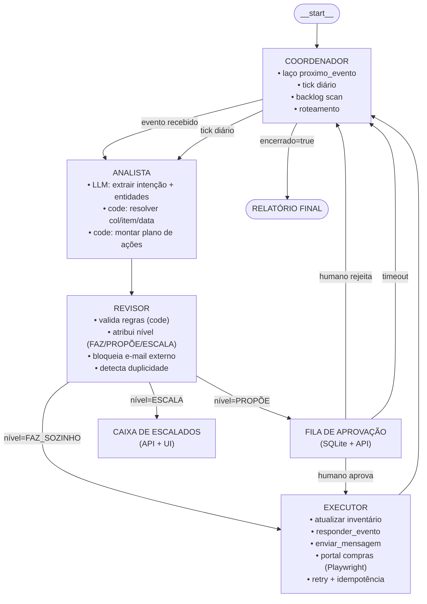

# Plano — Time de Agentes: Gestão de Equipamentos (Tema 3)

## 1. Grafo LangGraph



---

## 2. Schema do Estado (TypedDict)

```python
class AgentState(TypedDict):
    # Evento atual
    evento_id: str
    evento: dict                  # payload do proximo_evento
    origem: str                   # "cenario" | "tick_diario" | "backlog"

    # Resultado do Analista
    tipo: str                     # enum de 12 tipos
    entidades: dict               # patrimonio, colaborador_id, data, itens[], confianca
    plano: list[dict]             # [{tool, args, motivo, nivel}]

    # Resultado do Revisor
    plano_aprovado: list[dict]
    nivel_final: str              # FAZ_SOZINHO | PROPOE | ESCALA
    bloqueios: list[str]          # razões de bloqueio

    # Execução
    acoes_feitas: list[dict]      # {tool, args, resultado, tokens}
    resposta_remetente: str

    # Contexto compartilhado (injetado pelo Coordenador)
    data_simulada: str            # AAAA-MM-DD
    cache: dict                   # regras, catalogo, colaboradores (estáticos)
    pendencias: dict              # devolucoes, compras_em_transito, aprovacoes
```

Checkpoint: `SqliteSaver`, `thread_id = evento_id`.

---

## 3. Fluxo por Tipo de Evento

| Tipo | Dados consultados (code) | Ações | Nível |
|---|---|---|---|
| `duvida` | regras (cache) | `responder_evento` via template | FAZ |
| `consulta_estoque` | `consultar inventario` filtro status=disponível | `responder_evento` com contagem | FAZ |
| `devolucao` confirmada | `ler_evento`, inventario | `atualizar` status→disponível, `responder_evento` | FAZ |
| `resposta_cobranca` | inventario, pendencias | `atualizar` status→disponível | FAZ |
| `alocacao` / `reserva_kit` (≤R$500 estoque ok) | inventario, colaboradores, regras (cache) | `atualizar` status→reservado, `responder_evento` | FAZ |
| `alocacao` / `reserva_kit` (falta item) | catalogo (cache) | compra ≤R$500 → Playwright; >R$500 → fila | FAZ/PROPÕE |
| `troca_defeito` | inventario (item danificado) | `atualizar` situacao→danificado/quebrado + baixar + alocar substituto | FAZ |
| `emprestimo` | inventario, regras | `atualizar` + observacao com data | PROPÕE |
| `entrada_pessoa` (tick diário) | colaboradores, inventario, regras (cache) | reservar itens do kit; comprar se faltar + prazo | FAZ/PROPÕE |
| `saida_pessoa` (tick diário) | inventario, pendencias | `enviar_mensagem` devolução se não pediu ainda | FAZ |
| `baixa` | inventario | só com situacao em perdido/quebrado/danificado | FAZ/ESCALA |
| `entrega_compra` | compras_em_transito | atualizar pendencias, confirmar patrimônios | FAZ |
| `outro` / confiança < 0,7 | — | LLM reanalisa; se ainda incerto → ESCALA | ESCALA |

---

## 4. Tarefas Agendadas (Tick Diário — Coordenador)

Disparadas uma vez por dia simulado (`clock.py` detecta virada de dia pelos timestamps):

| Tarefa | Lógica |
|---|---|
| **Kit a preparar** | Para cada entrada em ≤2 dias úteis: verificar reservas; se faltar → Analista com tipo=`entrada_pessoa` |
| **Cobranças de devolução** | Para cada saída: calcular dias úteis desde data_saida; se ≥5 d.u. e ainda tem item → `enviar_mensagem` (se ainda não cobrou); se ≥10 d.u. → ESCALA |
| **Empréstimos vencendo** | Varrer `pendencias.emprestimos`; se hoje ≥ data_volta → cobrar |
| **Estoque mínimo** | Para cada tipo: contar disponível+novo/usado; se <3 → propor compra |
| **Backlog sem ação** | `listar_eventos(status="lido")` → filtrar sem acoes; reprocessar os mais antigos |

---

## 5. Estratégia de Retry / 504

```
503          → retry imediato; depois backoff 0.5/1/2s (máx 4 tentativas)
Lenta        → timeout=15s; não tratar como falha
504 em AÇÃO  → verificar ANTES de repetir:
               enviar_mensagem  → consultar mensagens (filtro para+assunto+evento_id)
               atualizar        → consultar inventario, comparar campos-alvo
               responder_evento → ler_evento, checar se já há resposta
               só repetir se confirmado que NÃO foi feito
504 em leitura → repetir direto (nada mudou)
409           → reconsultar registro + revalidar regra; retry máx 3x; se 409 de regra → replanejar
410           → parar ações; apenas relatório final
Circuit breaker → 5 falhas seguidas → pausar 3s; eventos preservados no checkpoint
Idempotência  → SQLite: hash(evento_id+tool+args) como chave; gravar "pendente" antes, "feito" depois
```

---

## 6. Uso do LLM (meta: ≤1 chamada/evento)

| Quando chama | Tokens estimados | Cache de prompt |
|---|---|---|
| Classificar intenção + extrair entidades | ≈300 completion | Sim — system+regras+schema fixos; só o corpo do evento varia |
| Redigir resposta sem template | ≈400 completion | Sim |
| Revisor reanalisa (confiança < 0,7 ou suspeita) | ≈300 completion | Sim |
| **Nunca** | bases inteiras, histórico longo, bases estáticas |  |

**Fallback**: se LLM falhar 3×, usar classificador de palavras-chave (Python puro) → tipo provável com confiança=0,5 → Revisor pode ESCALAR se necessário.

---

## 7. Estrutura de Arquivos

```
colaborador-digital-equipamentos/
├── src/
│   ├── mcp_client.py      # HTTP MCP + retry + idempotência + circuit breaker
│   ├── clock.py           # data simulada, dias úteis, tick diário
│   ├── rules.py           # todas as regras de negócio (puro Python, testável)
│   ├── templates.py       # respostas prontas por tipo
│   ├── llm.py             # chamada gpt-4o-mini + cache + fallback + log de tokens
│   ├── state.py           # AgentState TypedDict
│   ├── graph.py           # grafo LangGraph + SqliteSaver
│   ├── memory.py          # SQLite: aprendizados, pendencias, decisoes_humanas
│   ├── portal.py          # Playwright → portal do fornecedor
│   ├── api.py             # FastAPI: fila aprovação + escalados + feed
│   ├── policies.yaml      # níveis de autonomia editáveis
│   └── agents/
│       ├── coordenador.py
│       ├── analista.py
│       ├── revisor.py
│       └── executor.py
├── ui/index.html
├── tests/
│   ├── mock_mcp.py        # server fake com falhas injetadas
│   └── test_*.py
├── .env                   # NUNCA commitar
├── .env.example
├── .gitignore
├── requirements.txt
└── README.md
```

---

## 8. Estimativa de Chamadas MCP por Evento Típico

| Fase | Chamadas |
|---|---|
| proximo_evento | 1 |
| Analista (resolver entidades) | 1-3 (consultar) |
| Executor (ação + resposta) | 1-3 (atualizar + responder_evento + registrar_conversa) |
| **Total por evento** | **~5** |

Eventos com retry ou troca somam +2-3. Tick diário: ~3-5 consultas + ações necessárias.

---

## Aguardando seu OK para iniciar a Etapa 1.
